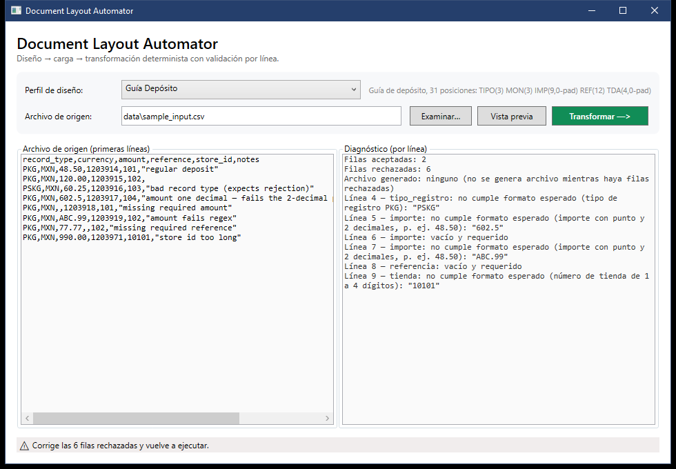
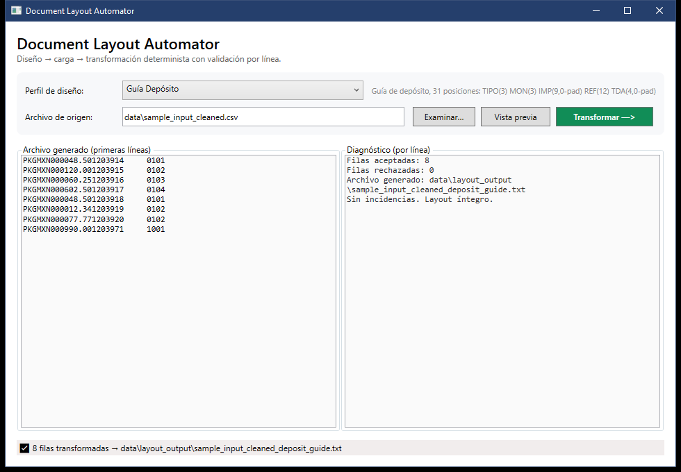

# Document Layout Automator

> **Status:** portfolio MVP. It has not been deployed and has no users. Both
> layout specs and all data in this folder are **synthetic**: they are not any
> partner's or employer's real layout.

**Problem it targets:** in clerical and billing operations, people often re-key
or re-format files by hand into rigid fixed-width layouts for a downstream
system. Mistakes are easy to make and hard to spot. A field that is one
character too long shifts every field after it.

**What I built:** a small Windows desktop app (`C# / .NET 8 WPF`) plus a console
runner. Both encode those layout rules once, validate every row, and refuse to
write a file that does not match the layout exactly.

## What it does

- Reads a **comma-delimited CSV with a header row**. Columns are looked up by
  header name, so their order does not matter, but names must match exactly
  (case-sensitive).
- Applies a **layout profile**: target field ← source column, fixed width,
  padding, requiredness, default on empty, a format rule with a plain-language
  hint, and date conversion.
- Produces lines that are **exactly the sum of the field widths**. A value that
  does not fit its field rejects the row. It is never truncated and never
  allowed to overflow.
- Rejects values with non-ASCII characters. The output is ASCII, so writing them
  would silently turn them into `?`.
- Reports every problem with **file line number, field and reason** in Spanish.
  "Filas rechazadas" counts rows. A row with several problems lists each
  problem but counts as one row.
- **Fail-closed:** no output file is written while any row is rejected.
- Writes `<source name>_<profile slug>.txt` (ASCII, one record per line, CRLF).
  The slug is defined in the profile (`deposit_guide`, `carrier_asn`).

The WPF window and the console runner call the same `LayoutRunner`. Same input
and same profile give the same output in both, byte for byte.

## Layout specs

Positions are 1-based and inclusive. "0-pad" means left-padded with zeros, and
"space-pad" means right-padded with spaces.

### Guía Depósito (`deposit_guide`): 31 characters per line

| Pos   | Width | Field           | Source column | Padding   | Rule                                                   |
|-------|------:|-----------------|---------------|-----------|--------------------------------------------------------|
| 1–3   | 3     | `tipo_registro` | `record_type` | —         | must be `PKG`; defaults to `PKG` when empty            |
| 4–6   | 3     | `moneda`        | `currency`    | —         | required; 3 uppercase letters (e.g. `MXN`)             |
| 7–15  | 9     | `importe`       | `amount`      | 0-pad     | required; digits, `.` and exactly 2 decimals; max `999999.99` |
| 16–27 | 12    | `referencia`    | `reference`   | space-pad | required; 1–12 digits                                  |
| 28–31 | 4     | `tienda`        | `store_id`    | 0-pad     | required; 1–4 digits                                   |

Example: `PKGMXN000048.501203914     0101`

### Carrier ASN (`carrier_asn`): 27 characters per line

| Pos   | Width | Field       | Source column | Padding   | Rule                                                        |
|-------|------:|-------------|---------------|-----------|-------------------------------------------------------------|
| 1–4   | 4     | `store`     | `store_id`    | 0-pad     | required; 1–4 digits                                        |
| 5–7   | 3     | `boxes`     | `boxes`       | 0-pad     | required; integer, max `999`                                |
| 8–15  | 8     | `kilos`     | `weight_kg`   | 0-pad     | required; digits, `.` and exactly 2 decimals; max `99999.99` |
| 16–23 | 8     | `ship_date` | `ship_date`   | —         | required; a real calendar date given as `yyyy-MM-dd`, written as `yyyyMMdd` |
| 24–27 | 4     | `warehouse` | `warehouse`   | space-pad | optional; defaults to `MX01`; max 4 characters              |

Example (`12,3,42.10,2025-03-04,`): `001200300042.1020250304MX01`

Numeric fields require exactly two decimals, so each amount has a single
representation: `602` and `602.5` are rejected, and only `602.50` is accepted.

## Design decisions

- **Reject, don't truncate.** A truncated amount or reference is worse than no
  file, so an oversized value is reported as `excede el ancho fijo de N caracteres`.
- **Fail-closed, all or nothing.** A partial file can be mistaken for a complete
  one. The trade-off is that one bad row blocks the whole file (see Limitations).
- **Rules live in code** (`services/LayoutProfiles.cs`), where they are covered
  by tests, rather than in a config file that operators edit.
- **Errors are data.** The engine never throws on bad rows. It returns
  `TransformError(line, field, reason)` records, so the UI and the CLI only
  display them.

## Layout

```
file-layout-automator/               solution: DocumentLayoutAutomator.sln
├── App.xaml / MainWindow.xaml(.cs)  WPF single-screen UI
├── models/LayoutProfile.cs          LayoutProfile + ColumnMapping definitions
├── services/LayoutTransformer.cs    deterministic mapping + validation engine
├── services/LayoutRunner.cs         read → transform → fail-closed write (shared)
├── services/LayoutProfiles.cs       the two built-in (synthetic) profiles
├── tools/LayoutCli/                 console runner over LayoutRunner
├── data/sample_input.csv            synthetic file with planted bad rows
├── data/sample_input_cleaned.csv    the same rows, corrected
├── sample_output/                   artifacts generated by tools/LayoutCli
└── tests/                           xunit: widths, overflow, dates, record type,
                                     row counting, ASCII, fail-closed, samples
```

## Sample artifacts (`sample_output/`)

These files are generated by the real code, not written by hand. The tests
re-run the engine and fail if any committed artifact drifts from its output.
To regenerate them from this folder:

```powershell
dotnet run --project tools/LayoutCli -- --profile deposit_guide --source data/sample_input_cleaned.csv --out sample_output --summary sample_output/run_summary_success.txt   # exit 0
dotnet run --project tools/LayoutCli -- --profile deposit_guide --source data/sample_input.csv --out sample_output --summary sample_output/run_summary_rejected.txt           # exit 1, no file
```

- `run_summary_success.txt` + `sample_input_cleaned_deposit_guide.txt`: 8/8 rows
  accepted. Every line is 31 characters.
- `run_summary_rejected.txt`: 2 rows accepted and 6 rejected, each with its line
  number and reason. **No layout file is generated**, so there is no
  `sample_input_deposit_guide.txt`.

## Screenshots

Rejected run on [`data/sample_input.csv`](data/sample_input.csv): 2 rows
accepted, 6 rejected with line numbers and reasons, and no file written:



Successful run on [`data/sample_input_cleaned.csv`](data/sample_input_cleaned.csv):
8/8 rows accepted, the generated file shown in the left panel:



Both were captured from the app built from this code. Start it with
`--source data\sample_input.csv` (or `data\sample_input_cleaned.csv`) from this
folder, then run `.\capture.ps1 -Name <file>.png`.

## Run / build / test

```powershell
dotnet build DocumentLayoutAutomator.sln      # .NET 8 SDK on Windows; builds with 0 warnings
dotnet test tests                             # xunit over the engine, the runner and sample_output/
dotnet run --project FileLayoutAutomator.csproj                                   # GUI
dotnet run --project FileLayoutAutomator.csproj -- --source data\sample_input.csv # GUI, demo file pre-loaded (first profile)
dotnet run --project tools/LayoutCli -- --profile carrier_asn --source <file.csv> [--out <dir>] [--summary <file.txt>]
```

Exit codes for `tools/LayoutCli`: `0` means the file was generated, `1` means
rows were rejected and nothing was written, and `2` means a usage or file error
(missing or locked file). By default the output goes to `layout_output/` next to
the source file, the same place the GUI writes to. `data/layout_output/` is
git-ignored.

## Limitations

- Not production software: no logging or audit trail of runs, no installer or
  self-contained publish, and no code signing. The transformation runs on the
  UI thread.
- The delimiter is fixed to `,`. A `;`-separated export fails on every row.
- There is no header schema check. A missing or misnamed column (e.g.
  `Currency` instead of `currency`) shows up as `vacío y requerido` on every
  row. For an optional column, the default is used silently.
- The CSV parser is minimal: it handles quoted cells with commas and escaped
  quotes, but not line breaks inside quoted cells.
- Input is read as UTF-8. A Windows-1252 export with accents in an *unmapped*
  column is read wrongly but does not affect the output. Mapped fields must be
  ASCII.
- There are no negative amounts and no implied-decimal formats. Amounts and
  weights must carry exactly two decimals.
- Profiles are compiled into the app, with no external configuration and no
  profile versioning. The GUI's `--source` start always uses the first profile.
- Fail-closed has no quarantine mode: one bad row blocks the whole file.
- The output file is not written atomically, and it overwrites an existing file
  with the same name.
