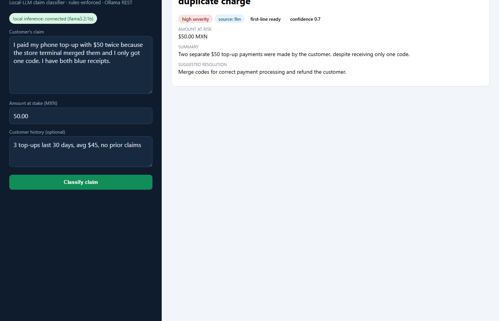
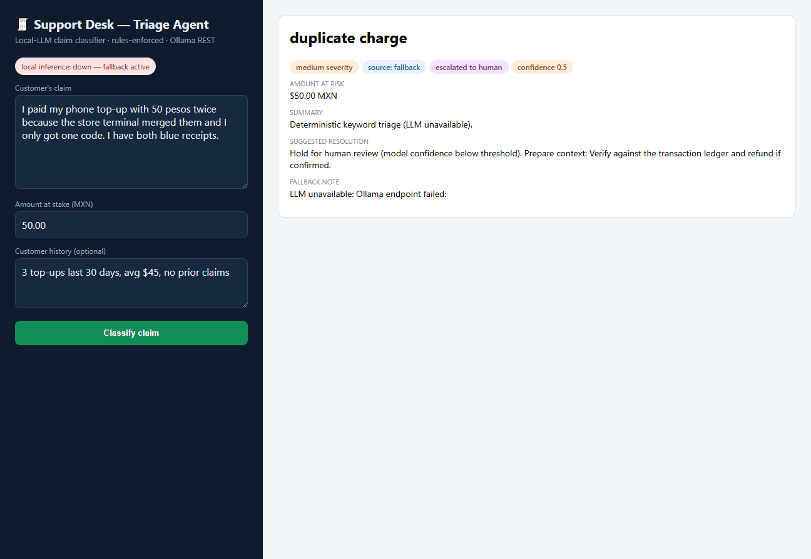

# LLM Support Desk

**Problem → Tool → Impact:** On a payments platform serving retail users through
cash networks (OXXO), transfers (SPEI) and cards, support and operations teams
triage high volumes of unstructured claims every day — inconsistent classifications,
no audit trail, and slow answers. Generic chatbot answers are not acceptable in
fintech: the flow must obey **deterministic business rules**, emit **structured
data** (for the ticketing system), and **keep data on-premise**.

This project is a user-facing web application that integrates a **local LLM
(Ollama via REST)** with the architectural controls a production deployment needs:

- **Controlled system prompt** — role, categories, and JSON output contract live in
  code (`prompts.py`), not in ad-hoc chat messages.
- **Dynamic context injection** — customer history and ticket text are injected as
  structured context, never concatenated blindly.
- **Structured output (JSON)** — the model is forced to `format: "json"` and the
  response is validated against a schema before use (`schema.py`).
- **Deterministic rules layer above the model** — refund eligibility caps,
  category whitelist, severity escalation and low-confidence escalation are
  enforced in `rules.py` regardless of what the model says.
- **Graceful degradation** — if the LLM is unreachable, a deterministic keyword
  classifier keeps the desk running (`service.py`); the UI shows the decision's
  source (`llm` vs `fallback`), so the audit trail never lies.

## Spin / OXXO angle

The exact architecture maps 1-to-1 onto an **Agent for Claim Triage** for Spin
operators: classify user claims (_duplicate charge / never arrived / unauthorized /
app error), summarize the customer's transaction history, and suggest the
resolution under company rules — with local inference so no transaction data ever
leaves the premises.

## Architecture

```
Browser ──POST /api/triage──► Python HTTP server
                                 │
                                 ├─► prompts.py      system prompt + context injection
                                 ├─► llm_client.py   Ollama REST (POST /api/chat, format=json)
                                 ├─► schema.py       validate/repair JSON contract
                                 ├─► rules.py        deterministic business rules
                                 └─► service.py      orchestration + LLM fallback classifier
```

## Run it

With Ollama installed and a chat model pulled (`ollama pull llama3.2:1b`):

```bash
pip install -e .                        # installs console script + dev extras
support-desk --port 8024 --model llama3.2:1b      # or simply: python run_support_desk.py
tests:  .venv\Scripts\python.exe -m pytest tests -q
```

No Ollama? The app still runs end-to-end using the deterministic fallback —
useful for demos in environments without local inference.

**Live inference** — a real triage decision rendered in the operator UI with the
local model connected (`source: llm`, first-line ready, confidence 0.7). The GIF
alternates it with the degraded mode (`source: fallback`,`escalated: true`), so
auditors can see both sources of truth the service emits:





The deterministic fallback in action (invalid/absent model output never reaches
the operator — the schema rejects it and rules escalate):


## Run it with Docker (CI/CD-ready)

Full deployment — model server, one-shot model pull and the triage API — in one
command:

```bash
docker compose up --build
open http://localhost:8000
```

The deployment itself is CI-verified (`.github/workflows/docker.yml`):

1. **`container-test`** — unit tests run *inside* the same multi-stage image
   that ships (`Dockerfile`, stage `test`), so there is no environment drift
   between what CI validates and what gets deployed.
2. **`publish`** — on `main`, the runtime image is published to GHCR
   (`ghcr.io/mvillarreal98/support-desk`), so deploying is a `docker pull`, not
   a rebuild. The container runs as a non-root user and carries its own
   `HEALTHCHECK` on `/api/health` (which stays green even in degraded mode, by
   design of the fallback).

Every knob stays env-overridable in the container (`OLLAMA_HOST`,
`OLLAMA_MODEL`, `SUPPORT_DESK_*`), matching `config.py`'s ops-first design.

## Layout

| Path | Purpose |
|---|---|
| `src/support_desk/prompts.py` | System prompt template + context injection builder |
| `src/support_desk/llm_client.py` | Ollama REST client (timeouts, error taxonomy) |
| `src/support_desk/schema.py` | The triage JSON contract: fields, types, validation |
| `src/support_desk/rules.py` | Business rules: refunds cap, escalation thresholds |
| `src/support_desk/service.py` | Triage orchestration + deterministic fallback |
| `src/support_desk/server.py` | Stdlib HTTP server + embedded UI (zero extra deps) |
| `data/sample_tickets.csv` | Demo claims modeled after real retail payment complaints |
| `Dockerfile` | Multi-stage: `test` stage runs the unit tests, `runtime` ships the app (non-root, with healthcheck) |
| `docker-compose.yml` | One-command full deployment: Ollama + one-shot model pull + triage API |
