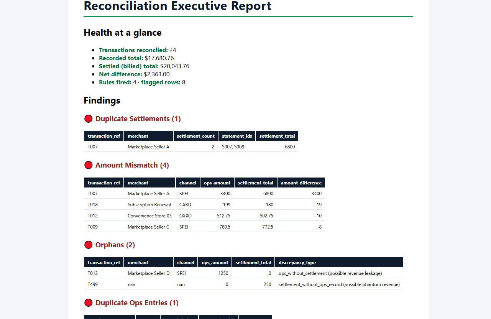

# Reconciliation Engine

Compares an **operational ledger** (what the system of record captured) with a
**billing/settlement export** (what the processor actually settled) and reports
every reference that does not reconcile: an executive Markdown report, one CSV
per rule, and a `rejected_rows.csv` with every input row it could not use.

The same rules run on two engines, **pandas** and **DuckDB SQL**; the test suite
requires both to return identical findings. All data in this repository is
synthetic (see [`data/Dictionary.md`](data/Dictionary.md)).

## Quickstart

Commands verified in a fresh virtualenv on Windows 10, Python 3.12.10, pandas 3.1.0
(the test suite also passes on pandas 2.3.3):

```bash
python -m venv .venv
.venv\Scripts\activate            # macOS/Linux: source .venv/bin/activate
pip install -e ".[dev]"           # runtime deps + pytest, pytest-cov, ruff, mypy

reconcile --ops data/ops_transactions.csv --billing data/billing_statements.csv --out output
reconcile --ops data/ops_transactions.csv --billing data/billing_statements.csv --out output --engine sql
reconcile --help

python run_reconciliation.py      # demo launcher: bundled data -> ./output next to the script, any cwd
pytest                            # 171 tests
```

`reconcile` options: `--engine pandas|sql`, `--tolerance` (currency units, whole
cents, default `0.01`), `--duplicate-window-minutes` (default `10`),
`--fail-on-findings`, `--log-level`. `--ops` and `--billing` are required;
`--out` defaults to `./output`. Progress and findings are logged to stderr.

| Exit code | Meaning |
|---|---|
| `0` | Run completed (with or without findings, unless `--fail-on-findings`). |
| `1` | Run failed: missing/unreadable file, missing columns, invalid option, broken conservation check. One log line, no traceback. |
| `2` | Run completed **and** a rule fired or a row was rejected, with `--fail-on-findings` (for schedulers/CI). |

## Outputs

| File | Content |
|---|---|
| `reconciliation_report.md` | Input integrity (rows read / processed / rejected per source), totals, net and gross difference, status per reference, findings, rejected rows. |
| `anomalies_<rule>.csv` | One file per rule, written on every run (header only when the rule did not fire), so a downstream job never reads a stale file. |
| `rejected_rows.csv` | Every input row that could not be reconciled, with source, row number, raw amount and reason. |

The committed [`sample_output/`](sample_output/reconciliation_report.md) is the
real output of `python run_reconciliation.py --out sample_output` on the
synthetic demo data; `tests/test_golden.py` regenerates it with both engines and
fails on any difference. Top of that report, rendered:



## How the input is treated

* **Everything is read as text.** IDs are compared exactly after trimming and
  upper-casing: `00123` stays `00123`, and `1001` never becomes `1001.0`.
* **Money is integer cents**, parsed from text without going through float.
  Accepted: optional sign, optional thousands separators, any number of
  decimals as long as the digits past the cents are zeros (`1,250.00`,
  `-300`, `10.500`). Rejected with a reason: blank, `$100`, `1.250,00`,
  `10.505` (sub-cent), more than 13 integer digits.
* **Nothing is dropped silently.** A row with a blank key or an unparseable
  amount goes to `rejected_rows.csv`; the report shows the count and the
  rejected amount (when it could be parsed) per source.
* **Conservation checks** stop the run (exit 1) instead of publishing a report
  that does not add up: per source, rows read = processed + rejected and the
  parseable amount read = processed + rejected amount; after matching, the
  matched table must carry exactly the processed rows and cents of each side.
* **Status** is case-insensitive. `refunded`, `cancelled`/`canceled` and `void`
  mean the expected net settlement is zero.
* **Negative amounts** (refunds/reversals recorded as their own movement) are
  reconciled like any other amount, sign included.

## Rules

Both sides are aggregated per reference and joined one-to-one (FULL OUTER
JOIN). Each reference then gets **exactly one status**; the first condition
that holds wins, so one problem is never counted under two rules:

| # | Status | Condition | Reported by |
|---|---|---|---|
| 1 | `cancelled_not_settled` | Reversed in ops, no settlement | — (expected) |
| 2 | `ops_only` | In ops, not in billing | `orphans` (possible revenue leakage; refund never settled if negative) |
| 3 | `billing_only` | In billing, not in ops | `orphans` (possible phantom revenue) |
| 4 | `currency_mismatch` | Currencies differ between sides, or one side mixes currencies | `currency_mismatch` |
| 5 | `settled_but_cancelled` | Reversed in ops, settlements do not net to zero (beyond tolerance) | `settled_but_cancelled` |
| 6 | `matched` | Reversed in ops and settlements net to zero | — |
| 7 | `duplicate_settlement` | Difference beyond tolerance and the same amount settled more than once (processor retry) | `duplicate_settlements` |
| 8 | `amount_mismatch` | Difference beyond tolerance | `amount_mismatch` |
| 9 | `matched` | Otherwise | — |

A split settlement (50 + 50 for a 100 charge) sums to the charge and is
`matched`, not a duplicate. Two more rules look at raw ops rows and explain
*why* a reference is off, so they may overlap with the table above:

* **`duplicate_ops_ids`**: the same `transaction_id` appears more than once in
  ops. Matching sums those rows, so totals are not inflated; the rule lists
  them with their file row numbers.
* **`duplicate_charge_candidates`**: captures with the same merchant, channel
  and amount, each recorded within `--duplicate-window-minutes` of the previous
  one, **and the group has fewer settled captures than captures**. Identical
  cash payments at one store on one day are normal, so an identical amount is
  not evidence on its own; a real double capture in the ledger settles once,
  two real payments settle twice. Rows without a parseable `recorded_at` are
  left out of this heuristic.

## SQL engine (DuckDB)

`--engine sql` runs the matching and every rule as plain SQL files in
[`src/reconciliation/sql/`](src/reconciliation/sql/):

* `matched.sql`: CTEs that aggregate each side, a `count(*) OVER (PARTITION BY
  transaction_ref, amount_cents)` window that spots repeated amounts, the
  `FULL OUTER JOIN` and the status `CASE`.
* one file per rule (`orphans.sql`, `amount_mismatch.sql`, ...).
* `duplicate_charge_candidates.sql`: gaps-and-islands with `lag()` and a
  running `sum()` window.

Ingestion, money parsing and rejection are shared, so both engines reconcile
exactly the same rows. Parity is asserted on the demo data, on 15 edge cases
and on 3 seeded random datasets (each with 3 window settings) that mix every
anomaly class
([`tests/test_parity.py`](tests/test_parity.py)). The SQL reads two tables,
`ops` and `billing`, with the cleaned columns listed at the top of
`matched.sql`, plus three variables (`tolerance_cents`, `window_minutes`,
`void_statuses`).

## Tests and quality checks

```bash
pytest --cov --cov-report=term    # branch coverage; fails under 85%
ruff check . && ruff format --check .
mypy src
```

171 tests: one or more per rule (each run on both engines), the 16 edge cases
found in the v1.0.0 review as regression tests, engine parity, the CLI exit
codes, the conservation checks, packaging (every runtime import is declared)
and the golden test against `sample_output/`. Measured coverage of the Python
package: 100% of statements and branches with pandas 3.1.0 and with pandas
2.3.3 (the `__main__` guard and a type-checking-only import are excluded; the
SQL files are exercised by the parity tests, which coverage.py does not
measure). Warnings are errors in the test
configuration, which is how a pandas 2.3 + numpy 2.5 deprecation in a
timedelta comparison was caught and removed.

## Performance (measured, synthetic data)

`python scripts/benchmark.py --rows N --workdir <dir outside the repo>`
generates N unique transactions per side (0.1% settled 5.00 higher; same
generator and seed as the benchmark used to review v1.0.0) and times each
stage. AMD Ryzen 5 5600X, 32 GB RAM, Windows 10, Python 3.12.10, pandas 3.1.0,
DuckDB 2.0.0; median of 3 runs at 100k, single run at 1M.

| Rows per side | Measurement | v1.0.0 | v2.0.0 |
|---|---|---|---|
| 100,000 | `aggregate_billing` | 3.85 s | 0.09 s |
| 100,000 | load → rules, pandas (no report) | 4.13 s | 0.86 s |
| 100,000 | full run incl. checks, report, CSVs: pandas / sql | — | 1.23 s / 1.32 s |
| 1,000,000 | load → rules, pandas (no report) | 42.4 s | 9.0 s |
| 1,000,000 | full run incl. checks, report, CSVs: pandas / sql | — | 12.7 s / 11.1 s |

v1.0.0 spent ~90% of its time in per-group Python lambdas inside
`aggregate_billing`; v2.0.0 aggregates with vectorized groupby (currency
min/max on integer codes) and builds the statement-id list only for
references that repeat. Both versions found exactly the 1,000 planted amount
mismatches at 1M.

Duplicate-charge heuristic, 1,000,000 unique transactions (none is a duplicate,
so every group reported is a false positive):

| Scenario | v1.0.0 (merchant + amount + day) | v2.0.0 |
|---|---|---|
| Every transaction settled, all recorded in the same minute (review benchmark) | 154,095 groups | 0 |
| 1% never settled (`--unsettled-share 0.01`), same minute | 154,095 (same ops file as above; v1.0.0 reads only ops) | 1,244 |
| 1% never settled, recorded over 10 hours (`--unsettled-share 0.01 --spread-minutes 600`) | 154,095 | 35 |

On the first scenario the drop to 0 comes entirely from the settlement
condition (every transaction settled); the time window cannot help there
because every capture shares one minute. The other two show what is left when
some transactions legitimately never settle. Both engines returned the same
counts in every scenario. With pandas 2.3.3 the 100k full run takes 1.34 s
with either engine.

## Known limitations

* **Gross comparison only.** `processor_fee` is accepted but ignored; a
  processor that settles net of fees would show every line as a mismatch.
* **No settlement-lag window.** `settled_at` is not used: a capture recorded
  near the cut-off that settles in the next file is reported as `ops_only`.
* **Exact-reference matching only.** No fuzzy or many-to-one matching across
  different references.
* **Duplicate charges settled twice are not detected.** Without a customer or
  payment-reference column, a customer charged twice (both captures settled)
  looks the same as two customers paying the same amount.
* **Mixed currencies are flagged, not converted.** Report totals add amounts
  across currencies; the report lists the currencies present.
* **One timestamp format per file**, inferred from the first value; other
  formats become empty and only affect the duplicate-charge heuristic.
* **In memory, single machine.** Both files are loaded whole. No scheduler,
  deployment or alerting is included; the exit codes are designed for one.

## Project layout

```
data/                   synthetic demo inputs + Dictionary.md
docs/                   screenshot of the sample report
sample_output/          committed output of the demo (golden test)
scripts/benchmark.py    synthetic scale benchmark
src/reconciliation/
  loaders.py            CSV ingestion as text, schema validation
  cleaning.py           normalization, money -> cents, rejected rows
  matching.py           per-reference aggregation, one-to-one join, status
  anomalies.py          pandas rules (registry of 7)
  sql_engine.py         DuckDB engine: runs sql/*.sql
  sql/                  matched.sql + one file per rule
  pipeline.py           load -> clean -> match -> detect -> report, conservation checks
  report.py             Markdown report and CSV exports (cents -> text)
  cli.py                `reconcile` console script, exit codes, logging
  config.py             tolerances, schemas, statuses
tests/                  pytest suite (both engines)
```

## Context

Personal portfolio project. The problem framing comes from the author's
billing work in freight (Central Transport: 240+ bills of lading a day and
1,000+ invoices a month; figures from his CV). None of that work's data or
code is in this repository, and no figure above describes it.
